# Feature guide

Every page and automation of the web client in detail. The [README](../README.md) has the overview, the map legend and
setup; [screens](screens/README.md) has a screenshot of every page. Per-release detail is in the app's version history
(Account › Server, or `app/rsweb/version.py`).

**Contents:** [Dashboard](#dashboard) · [Devices](#devices) · [Map](#map) · [Fleets](#fleets) ·
[Logistics](#logistics) · [Economy](#economy) · [Activity and tools](#activity-and-tools) ·
[How automation works](#how-automation-works)

> **Where settings live:** each rule's settings are on the page it works on, in a collapsed *Rules* panel at the top.
> The Automations page lists every rule with an on/off switch, plus the jobs (each says what its carriers carry or will pick up: devices and materials) and the log.

---

## Dashboard

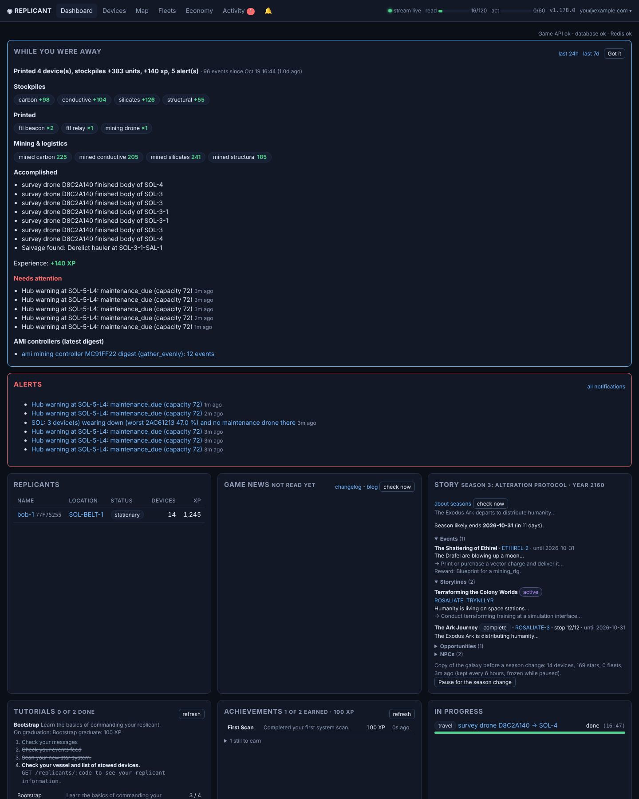

Cards can be dragged (⠿) or moved (▲ ▼) and folded (▾); the layout is remembered per browser.

| Card | What it shows |
|---|---|
| While you were away | a digest since your last visit (a 30 min gap starts a new visit; `/digest?hours=N` for any window) |
| Alerts, replicants, countdowns | open alerts, your replicants, live countdowns, fleet summary |
| Tutorial | the current tutorial's steps and the next step's hint |
| Achievements | earned ones (with XP and when) and the ones still to earn |
| Game news | the official changelog and blog, read every 6 hours; new versions and posts ring the bell |
| Story | `/overview`, every 30 minutes (see below) |
| Logistics backlog | is logistics keeping up? (see below) |
| Trends | devices by fleet role, mining output per hour, systems you can command and those your relay network covers |
| Stockpiles | with a 48 h trend, and "+ N in transit" |
| Game API health | API, database, Redis, checked every 5 minutes |
| Live events | the event feed |

**Story** (`/overview`): the season and its likely end, storylines, time-limited events (location, end date, reward), the
stars or datacenters involved, the Ark's stop, opportunities, NPCs. *Pause for the season change* is here too.

**Logistics backlog** (sampled every 10 minutes by the logistics pass, kept 30 days, 2d / 7d / 30d):
- resources in stockpiles other than a receiving stockpile (a stationed or materials-taking fleet home's drop point),
  set aside at a contract's or trade's location (up to what the open deals there still pay; a trade's payout and
  leftovers count as waiting to move), and aboard logistics devices;
- devices waiting to be moved: fleet strays, `to:` / `at:` devices not there yet, rescues;
- open and unmet logistics requests, request age and lead time;
- carrier use and hold fill;
- stalled and auto-retrying missions, expired orders.

**Trends**: mining output per hour is estimated from pile gains where something mines.

 

---

## Devices

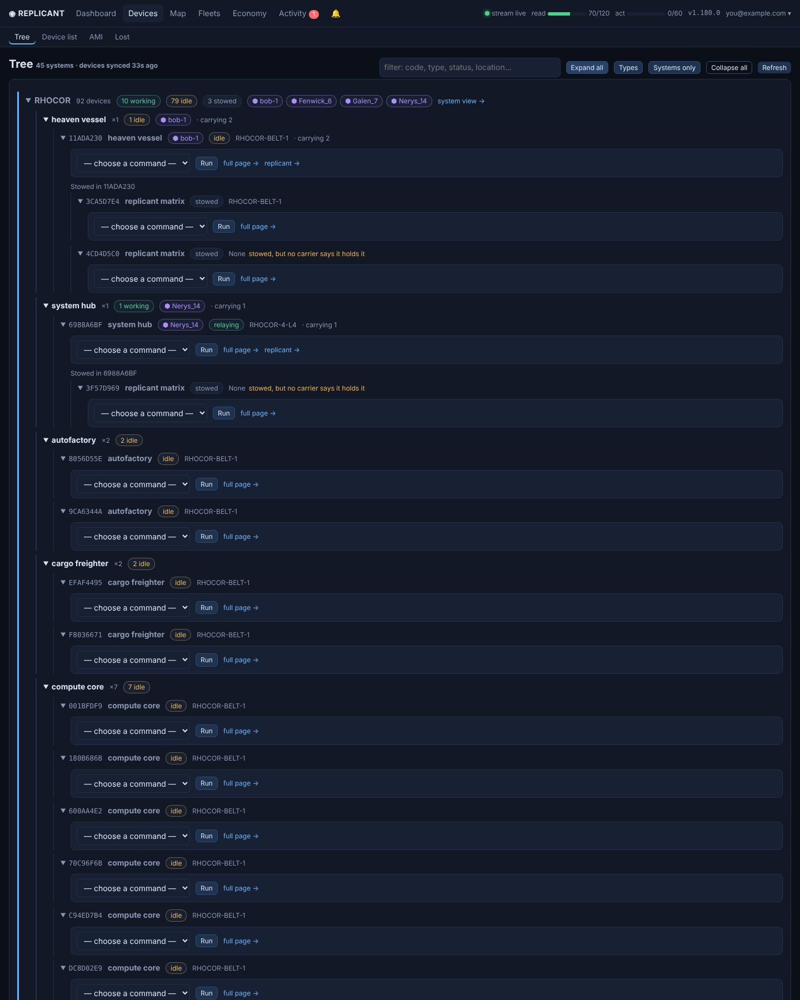

### Tree
System → device type → device, with stowed devices nested in their carrier; each device opens its command panel.

### Device list (`/fleet`)
- Every device, filterable by type, status, system, owning replicant, tag or text. The filters work in the browser
  (hidden rows are unticked), so switching one needs no server round trip; the URL keeps the filter.
- Tick devices (or all listed) to send them **one command**, or to **add tags** / **remove tags**.
- Devices that can't take it are listed and skipped: command not available, in use by an automation, a deploy/detach
  while the carrier is between systems.

### Device page
- **What it's doing**: its fleet's status for a fleet member; the current task and step for a logistics vessel or any
  device an automation job is working.
- Live detail, every available command with its fields (destructive ones ask first), tags, history and game log,
  cancel travel, the game's event log.
- **Permissions**: other accounts allowed to use the device, with grant and revoke.
- **Print queue** (autofactories): add (with an optional *deliver to*), remove, clear, and move a waiting print to the
  front, up or down. The game can't reorder a queue, so the waiting prints from that place down are taken off and
  queued again in the new order, tags and destinations kept. The print running now can't be moved.
- **Carrier** card (every carrier): launch / stow / recall for a hold, detach / attach for attach points. Devices too
  far to cruise over are picked up by the carrier, nearest first.
- Stow, deploy, attach and detach work **from either side**: the carrier's page lists its hold / attachments, the
  cargo's page lists carriers here (only the side the device fits).
- *Decommission at an autofactory* takes a device there so the autofactory learns its blueprint.
- `enqueue_print` on a replicant's vessel is sent as the replicant's own print (one at a time).

### Replicant page
- Route preview and travel (planned like automated trips: surge hops, a hub on the way, the off-ramp; the preview shows the time saved; device travel commands too) (with *then, on arrival…* follow-ups), nearest stars, scan, mining, vessel printing, profile
  editing, FTL slingshot, and the game's event log for that replicant (filter by event type).
- **Moving a replicant**: empty replicant matrices are listed with *Transfer* (same location, instant) or *Teleport*
  (another system, over the FTL network), each with a confirmation.

### AMI
Controllers with their latest digest, a directive picker with targets from the controller's system, adopt / release /
launch / withdraw, and **AMI schedules** that re-issue directives to idle controllers.

### Cockpit
- Fly the *swoop* debris run by hand. The picker lists devices with the swoop command first, then every replicant's
  vessel; a vessel that lists swoop links here from its device page and its command form.
- The run (live 2026-10-29): *Start swoop*, a 20 s warmup where moves are practice, then 5 rounds. Each round names a
  debris status (flanking, incoming, clear) with a description and a time limit; only the first move of a round is
  graded, later ones are ignored. The end gives passed and failed rounds, score and vessel damage.
- Full screen: the viewport draws the round's debris with a countdown bar; a throttle (boost, brake), a stick (dodge,
  dive, roll) and Start. Keys: W/↑ boost, S/↓ brake, Q/A/← dodge, E/D/→ roll, Space dive, Enter start. A game
  controller works too: stick or d-pad, A dive, right trigger boost, left trigger brake, Start.
- *What works*: every graded move tallied by its round's debris status (from the actions log and the round events), so
  the move that beat a status before lights up and failed ones dim. Buttons lock once a round is answered.
- Gauges: run time, round, passed, failed, score, damage and the round trip of the last command.
- Automations: a pass can stall the server for many seconds, so during a run (Start to swoop.complete, 3 min at
  most) no pass starts and a running one stops at its next step; the map serves its last data. The cockpit shows the
  engine (busy with time left, held, idle with the next pass), *Hold 5 min* / *Release*, and Start during a pass waits
  for it to stop (Start again goes at once).

### Lost
- Devices out of sight, with their last known location and where they're heading, until they're seen again (then
  listed under *Seen again*): surging, left out of the device list, out of relay range with no replicant in their
  system, or aboard a carrier that is.
- *Write off* stops tracking one.
- *Gone, with the reason*: destroyed by an asteroid, lost to a diversion, decommissioned, sent to another replicant,
  paid in a trade or to a contract, consumed by a print, contributed to a megastructure, held in a trade's escrow.

 

---

## Map

### Galaxy

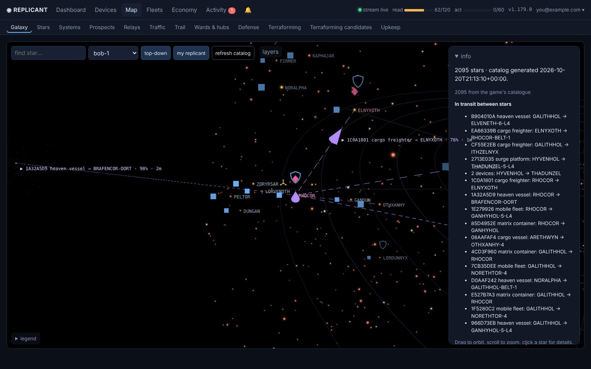

A live 3D map of the star catalog, plus stars from censuses and your observatories (your systems load first, the rest
of the catalog after). What each marker and line means is in the [map legend](../README.md#map-legend).

- **Live**: ships in transit, fleets (dashed routes run toward the destination, still under reduced motion), supply
  lines, mining sparkles and prospecting cones (each observatory scan: a wave running out to its reach) redraw as
  events arrive.
- **Tools**: relay/hub range, search, distances, route preview; right-click (on touch: long-press) two stars to measure
  (a third clears).
- **Layers**: every layer and each kind of marker has its own checkbox, grouped by how it draws (view, clouds and
  glows, rings and waves, lines, icons). Your choices are remembered in this browser.
- **Panels**: *layers*, *legend* and *info* fold away to leave room for the map; selecting a star opens *info* again.
- **Fading**: markers, mining sparkles and names shrink and fade with distance from the view's center, gone by 30 ly.
  Where names crowd, replicants, hubs and your systems keep theirs and the others fade out. A fleet or traffic label
  that would cover another fades rather than moving.
- **Region colors**: each galactic region is tinted its own color; the region at the view's center has none and the
  others fade in with distance.
- **Star sizes**: the Galaxy and System maps draw each star by its radius (the scan's `radius_solar`, else the typical
  radius of its spectral class, giants ten times that); the star's details say which.
- **Other players** (coral): their fixed devices from the latest device scans, a shield where someone else's ward or
  hub is, and an arrow for each arrival or departure your beacons logged in the last hour (with the likely other end of
  the trip), all fading with distance from the point the view is centered on. A replicant's vessel scans the devices
  of each system it arrives in (*Device scan on arrival*), which also adds any trade controller found to the shops list.
- **Trail**: the replicant you follow is drawn in gold.
- **Simulations**: on a run's galaxy map the star markers shrink to fit its tighter star spacing.

 

### Relays

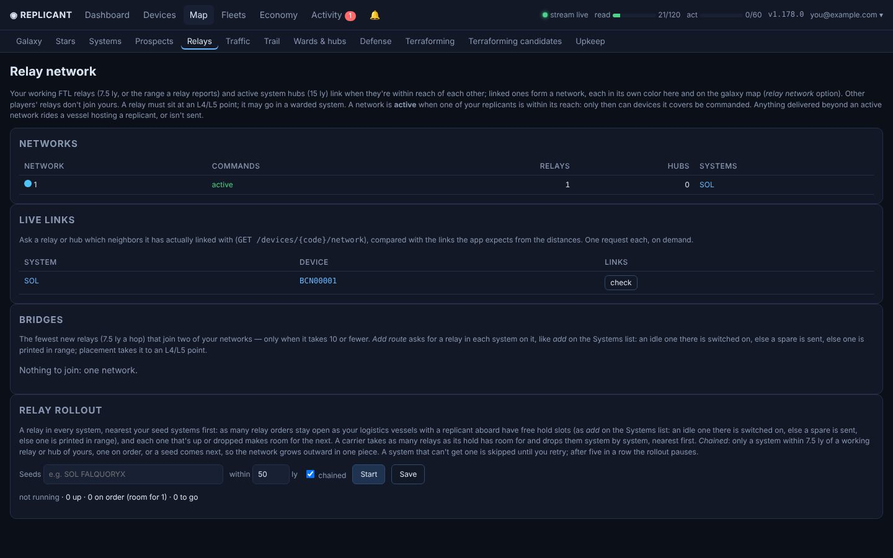

- **Live links**: asks any relay or hub which neighbors it has really linked with, and flags links expected but missing.
- **Networks**: working relays (7.5 ly, or the range a relay reports), deep space relay stations (10 ly) and active hubs
  (15 ly, by distance like relays, checked live 2026-10-15) that reach each other, each in its own color. Either end's
  reach links them (a relay 12 ly from a hub links to it).
  - **Active** when one of your replicants is within reach: only then can what it covers be commanded.
  - Range only links relays: a relay or hub delivers commands to its own system alone, so a network commands the
    systems it has nodes in, while a replicant is in one of them.
  - The range sphere per system is its working relay or hub that reaches furthest.
  - A relay out of range but on is a network of its own. Whether it's on: the last activate/deactivate,
    `relay.activated`, or the last time it was seen relaying or inactive.
  - A delivered relay is switched on before its carrier leaves.
  - A switched-off relay gets a red ring unless its system has a working relay or hub.
- **Suggested bridges**: the fewest new relays (at most 10) joining two networks, with *Add route* to order them.
  With *long-range stations* on, a deep space relay station goes where it saves devices (one of your systems may get
  one beside its relay); the page shows the station blueprint's cost.
- **Relay rollout**: a relay in every system within a radius of seed systems you name, nearest first.
  - Each seed has its own radius (a box per seed, or `STAR:ly` in the seeds list); unset ones use the default.
  - As many orders open as your logistics vessels with a replicant aboard have free hold slots (each as *add* on the
    Systems list); a carrier fills its hold with relays (and ordered beacons) for several systems and drops them
    nearest first. Beacons also ride surge plates, platforms and mobile fleets (attached, detached at the drop); a
    matrix container's slot is its cradle, so cargo for it rides on the platform it hangs on, and that platform counts
    as a replicant vessel.
  - *Chained* (default) only goes to a system within 7.5 ly of a relay or hub of yours, one on order, or a seed, so the
    network grows outward in one piece.
  - *Long-range stations*: once no system is left that a relay chain reaches, one within a station's 10 ly gets a
    deep space relay station. The Systems list has a *Station* column to order one by hand.
  - Once a plain relay would link a station's system just as well (the networks keep the same systems with the
    station cut to 7.5 ly), a relay is ordered there; when it works, the station is switched off and marked spare,
    one at a time.
  - A system that can't get one is skipped until *Retry skipped*; five failures in a row pause the rollout.
  - *Pause* cancels every relay print not started yet (print jobs, queued prints for a system, orders waiting on a
    print) and no order prints a relay until *Resume*; spares are still sent. *Pause prints* does the same while the
    rollout is stopped.
  - Prints only go to an autofactory with a free queue slot. A print order that never shows up in a queue (20 min)
    sends a spare instead or prints again, and its 3 days start over; with every queue full it waits (and doesn't
    expire) for a free slot.
- **On the galaxy map** (*relay network* layer, off by default): links are curves with no ring at each relay, solid for
  active networks and dashed for ones without a replicant; a hub's links are a darker shade of the network's color, and
  two relays both linked to the same hub don't show their own link. Relays on order are white rings, suggested bridges
  dashed gray.

 

### Stars
Unexplored stars nearest a system, with ETA and route; stellar census per vessel.

### Systems list
- Nearest first, by **distance** from the system picked under *distances from* (the same choices as Mining prospects;
  default: where most of your devices are).
- Per system, the **Fleets** homed there (⌂) or on a mission there (→).
- Your ward, FTL relay and FTL beacon, each with a checkbox (ticked: one works
  there or is on order) that saves at once without reloading the page, so several can be ticked in a row:
  - ticking: activate an idle one there, else send a spare, else print one in range (a relay is placed at an L4/L5 point);
    a printing hub's own keep-in-stock spares are sent last, after any other spare in range (1.297.0);
  - unticking: deactivate it and tag it spare (drops its `home:` / `at:` / `to:` tags; asks first), or cancel its order.
- Filters (remembered in the browser): relay / beacon / ward checked or unchecked, and civilization (has one, missing
  a beacon, all have beacons, none).
- ✦ marks a local civilization (green: your beacon is at its body). A beacon requested for such a system goes on to the
  civilization's body, pinned there (`at:`) so its carrier drops it at the body; a beacon already elsewhere in the
  system is carried there by a vessel in the system, or, with none there, pinned so the loadout pass sends a carrier.
  With several civilizations, each body gets its own beacon (*add* stays offered until all have one).
- **System tags** (at the bottom): every tag in your cached system scans with the systems carrying it (hazardous ones in
  red).

### System page

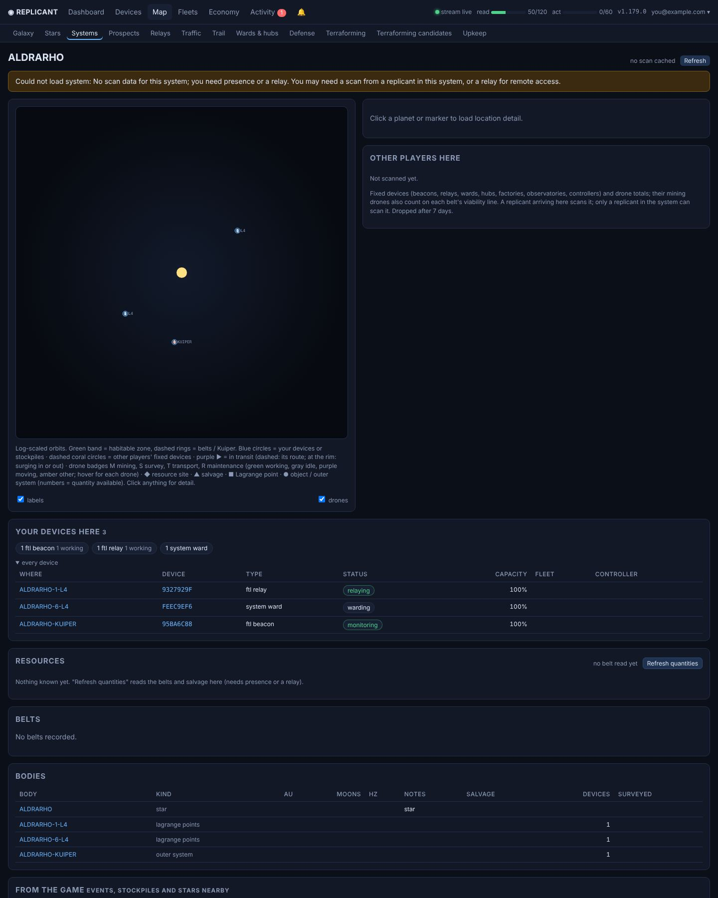

- A top-down map with your devices, stockpiles, sites and salvage. Working drones circle the site they work (a survey
  drone's tracking site, a miner's last mining event; else their location): miners and other workers clockwise; survey
  drones farther out, counterclockwise, with a light blue scanning beam aimed at the site.
- **Resources** card, per resource: richness, open sites, % left, ≈ units left (learned from what past sites gave),
  salvage, stockpiled.
- **Belts** card: richness, a viability line, open sites. **Bodies** card: planets, moons, L-points with their salvage
  and stock.
- Under Bodies, each system object of the scan (a megastructure such as a space station) folds out with its stage,
  status, progress, description, requirements (have / required) and contributors; **Full system scan** folds out the
  whole stored scan as JSON.
- Also: its lockers, the location events you've discovered there, the game's own stockpile figures, and the
  stars nearby (new ones join the map, like a census).
- *Other players here*: their fixed devices (beacons, relays, wards, hubs, factories, observatories, controllers) from
  the latest scan, also drawn on the map. A replicant arriving in a system scans it, or use *Scan for other devices*.
  Snapshots older than 7 days are dropped.
- An asteroid shows only while it's open; past ones are listed under Concluded on the Defense page.
- **Megastructures**: a megastructure's location page shows its progress and what it still needs, with a Contribute
  button for your devices there; `/megastructures` has the leaderboard.
- **Space stations**: megastructures of type `space_station`; the galaxy map gives them a silver wheel (lower right)
  instead of the hexagon. They come from system scans, plus the colony worlds the story overview names (kept in kv
  `colony_stations` after the storyline ends), so unscanned colony systems show one too.

 

### Prospects
- Scores every scanned system out of 100: each resource's yield (scarce 1 to rich 10) × belt density, weighted by
  rarity (rares 3, volatiles 2.5 … structural 1). These scores don't change with your stock. When a mining fleet picks
  its next home, a resource that waiting prints lack weighs up to 4× more (a low or falling stockpile counts too).
  Bootstraps score at full potential, unweighted. AMI mining schedules set to *gather evenly* run *maintain ratios*
  leaning toward what waiting prints lack (when the belt has it), and *Restart idle miners* picks that resource, first
  what the factories the drone feeds wait for, and only among what the belt's open sites still hold.
  Its *Mine one site at a time* option (off by default; drones without a controller only) sends each restarted drone to
  the open site with the least of its resource left, so sites run out in turn and their survey drones search again
  while the other sites keep the drones busy.
- A stationed fleet's home is scored for review only, marked *home*, when that fleet has miners (loadout or members); a hub home without miners is scored and open to mining missions; ⚑ marks systems where a fleet of yours is homed.
- **Ward** column, ⛨ yours / ⛨ theirs:
  - *add ward*: activates an idle ward of yours there, else sends a spare, else prints one in range on the autofactory
    with the shortest queue, then switches it on once deployed. A queued print gives way to a spare that turns up.
    25-ward cap.
  - *remove*: deactivates yours, marks it spare, and drops a print not yet started.
- Surveyed checkboxes per body.

### Traffic
Civilization contact (a beacon must sit at the body of the civilization's event), visitors, each beacon's audit log,
redundant beacons. How often beacons are read is a setting (default 10 minutes).

### Trail
- Follows a replicant through the audit logs of public FTL beacons: candidate systems with travel time and a travel
  button.
- *Follow to the end* keeps going until the target stops moving (for Bill, until it finds his AMI trade controller).
- *Reset trail* clears the beacons and logs when the target relocates.
- **Bill** (A8F48B26) always passes through SOL: with nothing to follow, or a cold trail, the follow picks him up there,
  and *restart from SOL* clears the trail and starts over. Leaving his shop he can't be followed (he resets to SOL), so a
  departure from his shop's system sends the follow to SOL. His BobNet posts about moving ("NOSOXA is in the rear-view
  mirror") clear the beacon logs, restart the follow at SOL and close his shop until it's seen again.
- Following starts only by hand here.

### Wards & hubs
Your wards (against the 25 cap), hub shield and upkeep with warnings, the `evicted_miners` log. Other players' warded
systems are left alone by every mining rule and mission.

### Defense

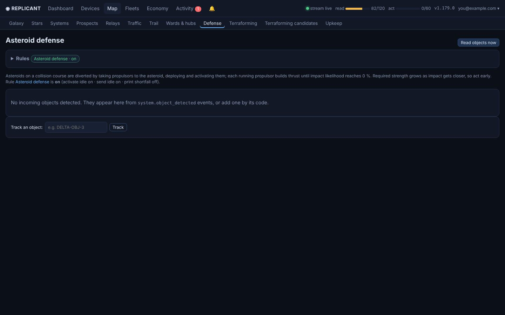

Incoming asteroids with a propulsor estimate and **Defend now**.

**Evacuation** (game v3.5.0: what's left at an asteroid is destroyed on impact or lost on diversion)
- Within the hour before impact, or at the game's `system.impact_warning`, your devices there leave for the system's
  entry point. One that can't fly boards a carrier there. Their `at:` pin to the asteroid is dropped, and a stockpile
  there is logistics' top priority.
- Propulsors still pushing stay, and leave 45 minutes before the impact (the rule's *leave* setting, at least 30). They
  are recalled as soon as the asteroid is diverted enough: impact likelihood at or below the Asteroid defense rule's
  setting (default 1 %, as it never reaches 0).
- An asteroid with propulsors on it is read every 5 minutes (also a setting).
- Once an asteroid is diverted enough or off target, only the propulsors leave early; everything else (mining rigs)
  stays until the hour before the ETA.
- Game v3.6.0: an asteroid the game reports `off_target` (it will miss) counts as diverted, since it's flung out of the
  system at the ETA; the card lists the resources left on the rock (mining rigs only).
- Nothing more is sent or printed for an asteroid due within the hour.
- An event is over once its impact time passes: it's no longer read, alerted or evacuated, and moves to the Concluded
  list. The card title shows the warning's destination.
- **Naming**: an asteroid is named by its location designation (STAR-OBJ-n). The game's impact warning names none and
  comes from where your devices are, so it's filed under the asteroid tracked in that system (else the system's scan
  names it at the next read), and the warned place is evacuated too. An asteroid whose designation a former rock used
  is tracked anew: the old rock's impact event doesn't close it.

**Asteroid mining** (rule, off by default, on this page)
- Devices with the `fracture` feature (mining rigs) at an asteroid mine one resource at a time, in the order of the
  rule's priority list (the first is the most likely to be finished, as yields taper), then the rest until it's dust.
- Idle rigs that can fly go to an asteroid in their system with a free slot (small 1, medium 2, large 5, shared with
  other players) when, after the trip (the game's travel preview), at least an hour of mining is left before the
  one-hour cutoff (a setting).
- Rocks you launched only give up the resources chosen for them and keep 5 % of each, so the impact still has its
  terraform effect.
- While rigs work, the rock's stockpile is a top-priority logistics pickup.
- An idle belt surveyor or survey drone in the system (belt surveyors first; else the one whose belt search started
  last, never one tracking a site) goes to a rock being mined and stays, scanning it every 30 minutes (a setting) for exact amounts until the cutoff. The card
  shows the scan and your rigs.

 

### Upkeep
Wear per system and maintenance coverage. Hub upkeep: each active hub's price per 20 % of capacity, the target kept at the
hub's own location (back to 100 % plus one step; the game draws upkeep only from there, with a maintenance drone
patrolling the system), what is there now and the logistics delivery that tops it up.

### Terraforming

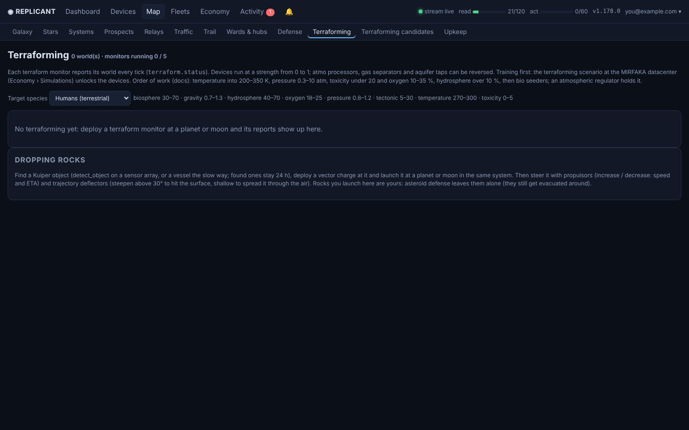

- Each world with a terraform monitor: its latest `terraform.status` (attributes, change per tick, projections
  +6/+12/+24, what drives them, warnings, anomalies), coupling rules active or close, bio seeder preconditions.
- Your terraforming devices with strength (0–1), direction (reversible ones) and on/off.
- **Dropping rocks**: detect Kuiper objects, launch one with a vector charge at a planet or moon, set propulsor /
  trajectory deflector directions. Rocks you launch are left alone by asteroid defense.

**Terraforming console** (this page, and a run's own with `?sim=`): each world is a live console that refreshes itself
every 15 s (not while you're using a control in it).
- A light per world, attribute and device group.
- A gauge per attribute with its value, change per tick, the target range and a graph of the last hour with the range
  shaded.
- A switch per device, a strength slider and direction for those that take one (shown as set), and all on / all off per
  kind.
- Every control updates the console at once. A switch or setting shows what you commanded (dashed while pending) until
  the game reports it, for up to 2 minutes; a world's controls are sent one after another.

 

### Terraforming candidates
- Surveyed planets and moons rated as terraforming targets for a species you pick, quickest first.
- For each: the gap per attribute and the time to close it with n devices of each kind (stacking 1 + ln n, side effects
  left out; bio seeders start once their preconditions hold), the devices it takes, the distance to your nearest
  autofactory and whether you can command there (both filters).
- Gravity outside the range, gas giants and intelligent natives are listed apart.
- *Read surveyed bodies* fetches their details (`GET /locations/<body>`), 25 a click, again after a week.

---

## Fleets

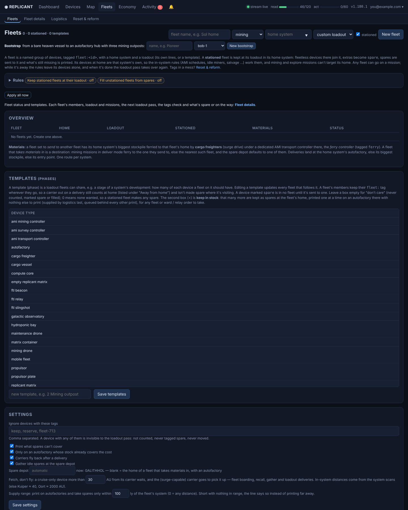

A fleet is a named group of devices tagged `fleet:<id>`, with a role (mining / explore / logistics / prospector /
rock chaser / bootstrap), a home and a loadout (its own lines or a template).

### Pages
- **Fleets** (the landing page): each fleet's status against its loadout (loaded just after the page), the templates and
  loadout settings, and the **Strays** card.
- **Fleet details** (the slower parts): an index of the fleets, each fleet's card (members, loadout, missions), what the
  next loadout pass would do, the tags & controllers check (kept an hour, Refresh rechecks), and what's spare or on the
  way. Each card loads as it scrolls into view; a name in the index (`?fleet=<id>`) opens that fleet alone, `?all=1`
  every card at once. A card's Add / remove devices list loads when opened.
- Both keep the loadout plan, prospects and destination lists for an hour (the engine still plans for itself every
  pass); any fleet or loadout edit and the **Recompute** button refresh them.
- **Reset & reform** for messy tags.

### Stationed fleets and the loadout pass
- The **loadout pass** keeps a stationed fleet at its loadout in its home system: extras become `spare`, spares are sent
  where they're short (within the supply range, default 1728 ly: the sector range), and what's still missing is printed and carried there
  (large devices are compacted first).
- Placed beacons and relays are never made spare or moved.
- **Fleets sort themselves out** (1.284.0): a device of one fleet run by another fleet's controller is released, so its
  own fleet's controller adopts it again (idle miners are only handed to their own fleet's controller, or a fleetless one).
  A fleetless device run by an unstationed fleet's controller joins that fleet while it has room for the type, else it
  is released (1.291.0).
  Members on their way home that haven't left yet are let go as spares where they wait once the fleet has its count.
  An unstationed fleet (survey, logistics, prospector) drops members beyond its loadout as spares the next time they're
  idle in a system with one of your hubs (home for repairs, say); *Fill from spares* (rule *Sort out unstationed fleets*)
  does it. A type left blank in the loadout is "don't care" and never dropped; set it to 0 to drop it. Never dropped:
  replicants' vessels, matrices, matrix containers, anything with a matrix or other devices aboard, a fleet's relays,
  beacons and wards, and reserved devices (`contract:`, `to:`, `at:`, ignored tags).
- **Belt surveyors** (said to search belts about 4x faster) are adopted by survey controllers (or search on their own without one), ahead of survey drones, wherever belts
  get searched or rocks scanned. In loadouts they are their own item, counted apart from survey drones.
- **Carriers**: a borrowed carrier only comes from within the supply range of the pick-up (the trip itself can be any
  length, e.g. a new home across the gap); a fleet's own carriers go anywhere. Deliveries use logistics-fleet carriers
  (or spare carriers in no fleet); any other fleet's carrier only picks up its own fleet's members and is never
  borrowed.
- Spares are only gathered to a depot within range.
- **Supplied from** (Overview): a hub whose autofactories print the fleet's shortfalls and whose carriers bring them, at
  any distance (e.g. a Sol-sector fleet supplied from a home-sector printing hub).
- **Keep in stock** (a *Stock* column beside *Want* in a fleet's loadout editor, and a second box (+) per type in the
  Templates grid, which the template's fleets follow): that many more of a type are kept as spares at the fleet's home.
  Spare gathering leaves those stock prints at the hub (1.284.1), so they aren't shipped away and printed again.
  A hub short of stock first takes another printing hub's extra spares of that type (beyond that hub's own stock, within
  the sector range): they're tagged `gather`, `stock` and `to:<home>` and a carrier brings them over as spares (1.287.0).
  Only what's still missing is printed.
- **Spare gathering**: idle spares go to the nearest receiving fleet's home within the supply range (1.286.0), or all to
  the spare depot when one is set on the Fleets page.
  - Spares in that system (and stock prints under way) count; what's missing is printed one at a time on an autofactory
    there that has nothing printing or queued, tagged `spare` and `stock`. When the home stockpile can't cover it, an idle
    autofactory at another printing hub within the sector range whose stockpile can prints it, tagged `to:<home>`, and
    a carrier brings it over (1.274.0).
- **Printing hubs share autofactories** (1.274.0): stationed fleets that take materials in (FALQUORYX, SOLARES) print
  for each other within the sector range (1728 ly). A fleet print goes to the other hub when its own stockpile can't
  cover it, and ward / relay / beacon orders prefer an autofactory whose stockpile covers the print. A hub further away
  (Delta at ISOLITHOR) keeps its autofactories to itself.
  - Any fleet or ward / relay order can take it (wards are only printed, never activated); once taken for a fleet or a
    system it loses both tags.
  - Stock prints are low priority: logistics supplies them last, and a waiting stock print is moved behind any other.
- **Materials** (Fleets overview): a fleet is *receiving* (takes materials in) or *supplying the nearest receiver*: its
  materials go to the receiving fleet nearest its home (recomputed whenever fleets change). A mission that ferries while
  mining delivers to the receiver nearest the belt it mines. A fleet set earlier to send to one named fleet keeps it.
- Also: owner hand-over (`change_owner`), *send to* / *takes materials in*, *fill from spares*, carrying budget.

### Nothing leaves short
- A fleet only sets off with its whole loadout in its home system (aboard, there, or arriving).
- A launch with gaps is refused (tick *Launch anyway* to send it short). A mission whose devices didn't all make it
  waits at gather, refilling from spares, until complete or *Launch anyway*. Auto-scout and auto-deals wait.
  A member with no room on the fleet's carriers stalls the mission (alert, auto retry); the note names any
  non-fleet cargo filling the hold, and *Launch anyway* leaves without that member.

### Moving to a new home
- A new home doesn't wait for the loadout: the loadout pass fills the fleet there.
- Surge-capable members don't hold a move up unless the fleet needs them as carriers: each flies straight to the new
  home from wherever it is, once it has finished its current task.
- A new home outside an active relay network stays *pending* (unless a replicant rides with the fleet) until a relay
  there joins one: nothing could be commanded there on arrival.
- **Mining fleets** have no assembly stage: their own carriers and the logistics fleets' each load as many members as
  they hold and leave as they fill.
- **Survey fleets** first collect every member (from other systems too), then move together in one relocation mission
  when their carriers seat everyone.
- A move stays open until every member is there: reported when complete, and once if members are still missing after
  two hours.

 

### Missions
- Run phase by phase (assemble → gather → travel → deploy → work → … → return → unload) with a log, *Retry*, *Stop*,
  *End mission & board* and *Recall*.
- **Auto-retry**: a stalled mission retries the stalled phase by itself after 15 min, doubling the wait each time up to
  6 h, eight tries in all (then it waits for *Retry*). One stalled out of comms range resumes once back in range
  instead. Only the first stall at a spot notifies.
- **Mining** works the richest belt (or salvage). **Explore** surveys each target; it no longer leaves relays or beacons
  (ask for those on the Systems list), skips an already-surveyed target, and the crew stays aboard at home.
- **Trade fleets** are retired: the logistics service does their work, and each one becomes a logistics fleet (same
  members and loadout) once its last run ends.
- A recall withdraws a launched AMI controller (its drones come back) before it boards.
- **Max cruise** (Fleets › settings): no automation sends a drone or AMI controller on a longer in-system cruise; a
  manual Travel that long asks first (surge-capable devices excepted). A survey member that far from its work spot rides
  the fleet's carrier there.
- Survey crews are never dropped at the Kuiper belt or Oort cloud (with the system still unknown they stay aboard until
  the work phase).
- Every automated trip logs its expected arrival; a step refused while something is still on its way waits for that ETA.

### Fleet roles and behaviors

| Behavior | Who | What it does |
|---|---|---|
| **Path forward** | stationed mining fleets | A heading; when the home runs dry the fleet picks the best system ahead and moves. Only systems it can command count (an active relay network there, or a replicant): no automatic assignment goes outside the network. Salvage counts like a belt (5,000 salvage ranks like a middling belt), so a salvage-only system can be next. |
| **Observatories** | any fleet | Prospect wherever they're deployed: the heading (else outward from Sol), then 13 other directions. Compact when every direction is used up or the fleet is leaving. |
| **Auto-scout** | explore fleets | Surveys the nearest unsurveyed systems within 100 ly of home, ring by ring (only inside relay coverage without a replicant aboard). Sets out at 85 % capacity, comes home for repairs at 50 %, and deploys its worn members so they can be repaired. |
| **Repairs** | mining and survey fleets | A member at or below 50 % while it works is sent home (it recalls, returns and unloads as usual); back home, members below 85 % are deployed from their vessel to be repaired. |
| **Prospector** | a galactic observatory and a carrier with an attach point | A tour of the stars within 30 ly of home. Each star is prospected from once (the game allows one prospect per star), aimed at the emptiest hemisphere; then the observatory compacts and the carrier takes it to the next star: the emptiest neighborhood not prospected from yet, nearer first, commandable, and not another prospector's. A tour that hasn't moved on or prospected for 12 hours, or has no star left in range, raises a warning. |
| **Rock chaser** | mining rigs (fracture), a carrier, and best a hauler, a survey drone or belt surveyor, a sensor array and vector charges | Mines asteroids inside relay coverage: in its home system only (mode hub) or roaming to covered systems within its radius (100 ly, never past the sector range). Target criteria on Fleet details: smallest mass class, resource priority, hours of mining left after the trip (2), when to leave (80 min before the ETA, at least 60), ship-at amount (50), drop spot, what to keep on rocks you launched. It picks the best rock (own system first, then the wanted resource, then the most hours; never another chaser's), checks the trip with the game's preview, carries the rigs there, deploys them and mines one resource at a time (the asteroid mining rules; its own rigs are left out of that rule). The survey drone stays and scans. A fleet hauler takes the rock's pile to the drop (else the system's entry point) as soon as it reaches the ship-at amount, and logistics treats the pile as a top-priority pickup too. At the leave time, or once the rock is mined down, the rigs stop, everyone boards at once and the carrier flies straight to the next target (deploying and mining there) or the safe spot, with the last load shipped beside it; the defense evacuation at the hour stays the backstop. A sensor array in the fleet sweeps the Kuiper belt every 24 h and marks objects of at least the mark-from size for launch: launch one at a planet or moon from the card, or turn on auto launch at the launch-at body. A fleet vector charge flies there (or rides the carrier while the fleet has no target) and detonates. |
| **Logistics** | logistics fleets | No missions: see [Logistics](#logistics). |
| **Bootstrap** | a replicant's vessel | See [Bootstrap fleets](#bootstrap-fleets). |

### Strays
Every tick the app lists members of stationed fleets that aren't in their home system (spares, placed relays and
beacons, replicants and matrices left out), with where they are and why.
- One riding another fleet's idle carrier is let off there so the loadout pass can bring it home (logistics carriers
  bring them home themselves).
- One away an hour with nothing bringing it is reported once.
- Before any carrier leaves on a trip, members of another fleet riding it that the trip would take away from their fleet
  (not going to their fleet's home, not named in the job, not the job's or the carrier's fleet, not a replicant or a
  matrix) are let off where it is first; the loadout pass then brings them home.

### Bootstrap fleets
From a bare heaven vessel (three mining drones and a replicant aboard) to an autofactory hub with three mining outposts.

1. **Home**: the drones mine the best belt, the vessel mines onboard what they get little of (usually rares and
   volatiles), and the replicant prints survey drones and miners until the hold-sized kit is built. A home another
   player has warded, like Sol, is skipped.
2. **Survey** every system within the radius (10 ly), then **your OK on the hub**.
3. **The move** there, compounding to an autofactory printed on site, and the hub becomes a stationed fleet that takes
   materials in.
4. **Outposts** (**your OK on each**) must keep the relay chain (each within 7.5 ly of the hub or an outpost; else a
   relay waypoint, also your OK), and send their materials to the hub by cargo freighter. The hub's autofactory prints
   their kits and the heaven vessel ferries them in its hold (10 seats); the hub keeps only a surge plate (1 seat) for
   short single trips, no surge carrier.

- **A dry hub**: when the hub's autofactory waits 3 hours for a resource no open site at the hub belt holds (and the belt
  yields it low or worse), the card offers a **supply system** within 7.5 ly whose belt has it (your OK). Part of the
  hub's miners (*supply miners*, default 4) and survey drones (one per two miners) move there. The vessel prints a relay
  for each system, a surge plate and a transport hauler at the hub, ferries the drones and the relay over, and goes home
  once both relays are on. The hauler rides the plate and brings what the hub waits for whenever the supply belt has all
  of it it can give, or a full hold.
- The hub and every outpost get an AMI mining controller (`maintain_ratios`: the mix the bootstrap's missing devices
  cost) and an AMI survey controller (`belt_search`). While the salvage rule has one on salvage or resting at a dry belt,
  the bootstrap leaves it alone.
- **Start** with *New bootstrap* (a replicant's vessel and what's aboard), or pick the *bootstrap* role on an existing
  fleet that has a replicant's vessel and Save. Set its Home on the card to start somewhere else (a system with a belt);
  choosing the hub moves the home there.
- *Back to a normal fleet* (with the role you pick) makes it a stationed fleet again, homed where most of its devices
  are; a running mission stops, and a deployed matrix of its replicant boards the vessel first.
- The Fleets overview shows a bootstrap's stage.
- Hub and outpost candidates skip systems with an incoming object, and past asteroids or hazard tags lower their rank;
  the autofactory waits while a rock heads for the hub.
- Its devices are never rescued home when out of range (it leaves drones mining behind on purpose), its home piles are
  never returned, and the home kit leaves hold room for what else rides aboard (a matrix, a slingshot).
- A ward goes up where it costs under 6 hours of the system's output, or at once when another player's drones mine there.
- Everything it prints is tagged `boot:<id>`: the loadout pass never lends it others' spares, factories or carriers, nor
  lends its own.

### Hand tags

| Tag | Effect |
|---|---|
| `to:<system>` | sends a device there (its carrier is found for it) |
| `at:<location>` | pins it to a spot |
| `to:<location>` | e.g. `to:sol-3`, is rewritten as `to:sol` + `at:sol-3` |

---

## Logistics

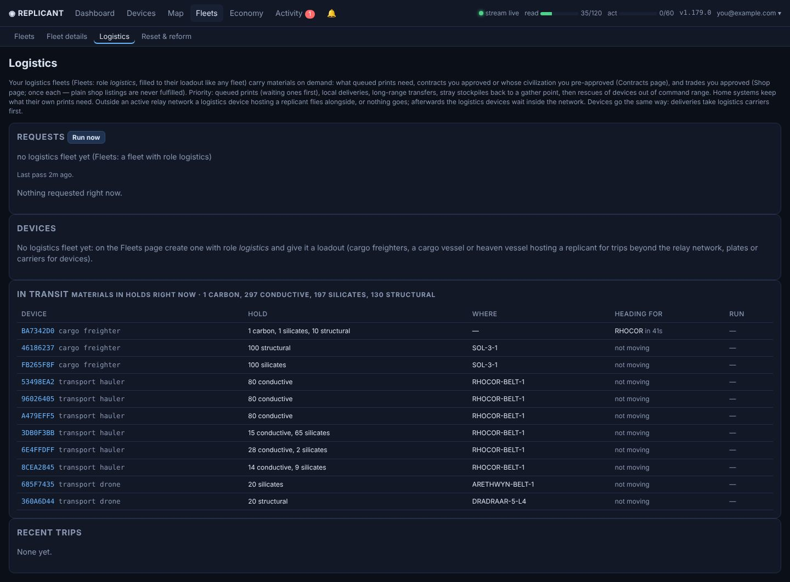

Logistics fleets (Fleets › Logistics) have no missions: their devices deliver materials and devices on demand.

### Task categories
- Each request has a category: queued prints, trades & contracts, rescues, shop listings, repair patrols, hub upkeep,
  stockpile returns. Every free carrier is given one category that has work and keeps it until that category runs dry, so a small
  category isn't starved by a big one (a category with work and no carrier takes one from the biggest).
- Evacuations (priority 0) go first with every carrier. Carriers left over after each category's turn help any
  category; stockpile returns (reallocations) only get leftovers, last. The Devices card shows each carrier's category.

### Where they wait
- Idle logistics devices inside the relay network gather at the nearest printing hub (a fleet that takes materials in):
  they fly there, or a free logistics carrier tows them. A stationed logistics fleet stays at its own home.
- Afterwards everyone waits inside the network.
- **Carriers per hub** (one logistics fleet for every hub): carriers still take any job, nearest first, and stay where it
  ended. Each hub within the sector range of the logistics fleet's home gets a share of every carrier class (big attach
  carriers, replicant vessels, surge plates, cargo vessels, cargo freighters), weighted by what needed a carrier near it
  over the last 3 days (logistics requests, loadout pick-ups), at least one each. A carrier idle for 30 minutes at a hub
  more than the leeway over its share flies to the hub furthest under it (more than the leeway under, or with none), one
  per class per pass, and never back the way another of its class is still flying. The leeway (default 25 % of the share,
  at least one carrier; 0 = strict) is set on the card. A carrier on a job counts where the job takes it. The Logistics
  page shows have / share per hub.
- The page's **In transit** card lists every hold with materials in it (what, where, heading for, which run), with
  totals.

### Requests, in priority order
0. **Evacuation**: stockpiles at an asteroid due to hit or be diverted.
1. **Queued prints**: their cost minus what's stocked, waiting ones first.
2. **Local delivery** and 3. **long-range transfer**:
   - contracts you approved or whose civilization you pre-approved (Contracts);
   - trades you approved (Shop: *Logistics buys* n, 0 = not approved: one delivery pays n prices and the trade runs n times, at most
     the stock; plain shop listings are never fulfilled);
   - a home system's piles consolidated at its drop point (its autofactory, else its biggest pile; systems the
     Consolidate rule covers with an AMI transport controller are left to it).
4. **Stockpile returns**: stray stockpiles brought back to a gather point (a fleet that takes materials in), or, where
   such a fleet moved away, to its new home. Not from a system an AMI ferry already empties; a return load that finds
   less than planned takes what is left. With no gather point, the page says so. A delivery outside a hub's system
   also brings a stray pile near its drop-off (same system or one relay hop) back to the nearest printing hub on the
   way back, instead of flying home empty (*on the way back …* in the job row).
5. **Rescues**, 6. **shop listings** (*Get listing*), 7. **repair patrols**.

Bump or skip a request on the Logistics page. Every logistics job still going has *Cancel job* there (and *Confirm trip* when a long trip waits for your Confirm), on its request row and under Recent trips.

### How a delivery is planned
- A print delivery to another system leaves with its hold at least a quarter full (or carrying all that's wanted); a
  smaller load waits for more to be spared, also when a print is stalled if the trip is longer than 15 ly.
- **Hub reserves**: home systems keep what their own prints need, but hubs share that reserve so each one's print queue
  is paid for about as many hours ahead (print time over its autofactories). The one with the fewest hours gets what
  its next print lacks from the one with the most, while the giver still has at least as many hours left.
- Inside one system a free AMI transport controller (drones / haulers) gets the delivery as a `delivery` directive;
  logistics covers what it can't.
- **Reach**: logistics reaches every logistics device however far (the supply range doesn't limit it), so one logistics
  fleet serves everywhere, but carriers only serve stars within the **sector range** (1728 ly): a far sector needs a
  logistics fleet of its own.
- **Ships** are picked nearest first (by relay hop), then the smallest that takes the rest in one go (else the
  biggest), and as many as the load needs go at once, as one convoy. Freighters and cargo vessels fly themselves (a
  freighter is too large to attach); haulers and drones stay in their system unless they ride (attached) on a free
  logistics carrier (plate, platform, carrier, fleet carrier). A hauler or drone in another system than the
  stockpile is fetched by that carrier first: it flies over, the hauler attaches, and it is towed to the pile to load.
- A ship still holding what's needed (say, from a trip that failed) is used first, and delivers without picking up again.
- Device deliveries (and fleet moves done piecemeal) take logistics carriers first.
- **Batched deals**: contracts and trades at the same location share one delivery. What's there pays the first ones,
  one trip brings what all the others lack (as far as the carriers hold) and its replicant fulfills them all.
- A deal's own pile is kept for it: no other delivery loads there. Devices a deal asks for count as there when they
  sit out of command range in its system pinned (at:) to its location, since the game then names only the star.
- Every vessel in a logistics fleet is available to automation, replicant vessels included (moves of stationed mining
  fleets, deliveries, beacons). While an approved shop trade waits, device runs leave those with a replicant free for
  it. Another fleet's replicant vessel is only used as the escort a trip beyond the network needs.
- Relays go first: where relays or beacons wait for an escort beyond the network, the nearest free logistics vessel
  hosting a replicant (within the supply range) is left to the loadout pass (Logistics page: *Kept free to escort*).

### Beyond the network
- Deliveries draw on stockpiles beyond the network too while a replicant is free to go along.
- Outside an active relay network, one device hosting a replicant goes with the whole convoy, or nothing goes. A carrier
  with a replicant's matrix aboard (a fleet carrier holding a matrix container) counts.
- When a delivery completes a contract or trade, that replicant fulfills it, and the convoy loads the payout there and
  brings it to the nearest gather point (devices paid out are sent there as deliveries).
- A trip planned without an escort checks again before it leaves and stays put if its destination has gone out of
  comms range.

### Rescues
- A device out of command range is brought home: its fleet's home, else the nearest covered home.
- Excepted: placed relays and beacons, wards, hubs, fleets on a mission, and devices tagged `at:` the spot where they are
  (stocked there on purpose), devices reserved for a contract (`contract:`), and devices tagged `to:` another system
  (their own trip takes them there).
- One that can surge is reached by a replicant in its system or anywhere its dark relay network covers, and commanded
  home. One that can't is picked up from its last known location by a carrier with a free seat, a replicant along.
  The seats every device stranded in that system (for the same home) needs pick the carrier: the smallest that seats
  them all, else the one that seats the most and the rest get another; seats to spare pick up rescues within 15 ly. Out of range the game names only the star, so once the replicant is in the system the carrier goes to
  each device's own spot. A device pinned (`at:`) in the system it's stranded in counts as stocked there.
- A rescue whose trips add up to more than the **sector range** (a day at the game's 50 s/ly), or to a star whose
  position isn't known, waits for your **Confirm** on the request (one alert; the OK holds two days).
- **Pause rescues** (Logistics page): all of them, or one fleet's devices, for 6 h to a week or until resumed. Paused
  requests stay listed but nothing is sent; a rescue already under way goes on.

### Repair patrols
- Repair devices in a logistics fleet (only those) go where the wear is. A system wants one repair device per six
  devices below the Maintenance rule's worn level, counting any already there or on their way.
- The systems missing the most capacity go first (then the lowest device).
- A free logistics carrier picks one up from a system that has enough without it (one mid-repair finishes first), drops
  it at the worst device and sets it to `patrol`; one that can surge flies itself.
- Only to systems the relay network covers or a fleet's home (not one lit only by a passing replicant), never one with
  an asteroid due. Trips over a day wait for **Confirm** like rescues.
- A logistics repair device in a system that needs it is set to patrol there, and none of them gathers at a hub.

### Drop-offs
- An idle logistics carrier drops off what isn't its work at the nearest receiving point inside the network (a fleet
  that takes materials in, or one of your system hubs): leftover cargo is deposited, and riding devices are deployed or
  detached there.
- Never dropped: logistics devices, a replicant, a matrix, a matrix container or anything with a matrix inside, devices
  on their way somewhere (`to:` / `at:` tags), and members of another fleet (the carrier takes them to their fleet's
  home, one home per trip, the nearest, and lets them off).

 

---

## Economy

### Component prints
Some blueprints use up component devices (e.g. a biosphere cultivator: 2 hydroponic bays, a nutrient synthesizer, an
orbital farm), deployed at the factory. Every print the app queues (manual ones included):
1. counts the components already at the factory (deployed there or queued there, less what earlier prints in its queue
   use up);
2. pins spare ones from elsewhere to the factory;
3. puts the rest ahead of it on the same factory, with the item's tags (its location pins swapped for the factory's).
   One the game won't print (a locked blueprint) is logged and the item queued anyway.

Components are tagged `component` and pinned to the factory (`to:`/`at:`); the item's spare, stock and fleet tags
don't pass on, so no fleet counts them, the loadout pass never makes them spare, and no other factory takes them.

A factory already waiting for components first claims the ones of that type already at its location (tags them
`component`), then gets free spares pinned to it, or the rest printed at another autofactory (every 5 minutes).

### Blueprints

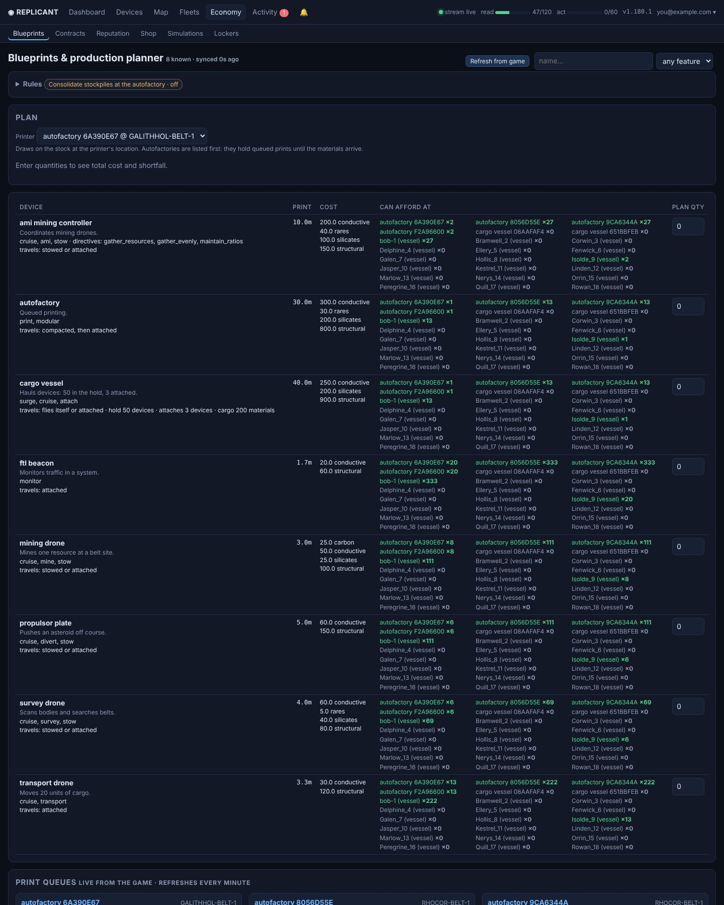

- How each device travels between systems (flies itself, stowed, attached, or compacted then attached) and what it
  carries (hold and attach slots, cargo).
- Every other field the game sends that has a value (relay range, print queue slots, strength, current hubs, and any new
  one), the full description, costs (component devices included, with an all-in material total) and print times.
- What each printer can afford (a *hide vessels* checkbox leaves replicant vessels out, remembered in the browser).
- A production planner that queues prints (spread over several autofactories) and can mine or deliver the shortfall.

 

### Contracts
- In-game events with criteria (any one option completes it), rewards and progress.
- Options that ask for devices show how many of each type are tagged spare and the option's total cost in resources
  (what it asks for plus the devices' blueprint costs).
- A beacon mark per civilization: yours at its body, only in its system, or none.
- *Send replicant*, *deliver materials*, *fulfill*.
- **Deliver devices** sends spare devices to a contract's location; printing what no spare covers waits for
  **Authorize printing**.
- **Restart prints** forgets prints no autofactory still holds (dropped from a queue, a factory gone) and prints what's
  short again.
- A Trades section (as on Shop).

### Reputation
Account and per-replicant reputation, known species. **Bulk profile import**: paste JSON `{code or current name: {name, description, plan, project, pronouns}}`, preview the changes and problems per replicant, then apply (one profile edit each, changed fields only).

### Shop
- Your trade controllers, trades, other traders: every replicant's trader directory plus every shop a system scan lists,
  the newest sighting of each winning (shops can move).
- A shop stays listed until you remove it (*Remove*, once you checked it's gone): scans can miss shops, and a failed
  trade only stalls the run.
- An owner's BobNet post that the shop "is open for shoppers" (with "Find me in the Oort") moves it to the poster's
  system and spot, or lists it until its controller is seen.
- *Refresh traders* says how many replicants it asked and how many traders the game listed. The game's directory has the
  shops in each replicant's own system, and others only where the owner has an FTL relay and you have one there.
- *Get listing* reads a shop's trades (the game shows them only to a replicant in the shop's system): at once if one of
  yours is there, else logistics brings one at the lowest priority (tier 6). Bill's too, once his shop is seen again
  after a move; his trail is followed only when you start it on the Trail page.
- Bill is the exception: his BobNet post that he moved closes his shop until it's seen again.
- A trade run paid in devices gets spare ones delivered and deployed at the shop.
- Each trade has a quantity: *Buy* buys that many one after another (the game sells one unit per call) and stops at
  the first refusal; *Logistics buys* n (0 = not approved) has logistics deliver n prices and execute it n times. The number
  is the outstanding balance: it counts down as units are bought, so units a trip couldn't buy are delivered and bought later.

### Lockers
Equipment lockers are NPC devices that hand out a set loadout once per account (e.g. SOL-OORT, TWAFFY-OORT).
- Once its price is all there, a locker's row offers **Retrieve** (it scans from your replicant at the locker and
  retrieves). Or scan where a replicant is and retrieve from the result.
- **Deliver** sends a locker's price there: spare devices pinned to its location (which drops their spare tag), the
  rest printed, spread over the autofactories at one stockpile. Carriers drop them right at the locker, and fetch any
  left elsewhere in its system.
- Device scans on arrival record every locker they see (code and location), new ones included, and Retrieve uses that
  code. Each system's page lists its lockers.

### Simulations

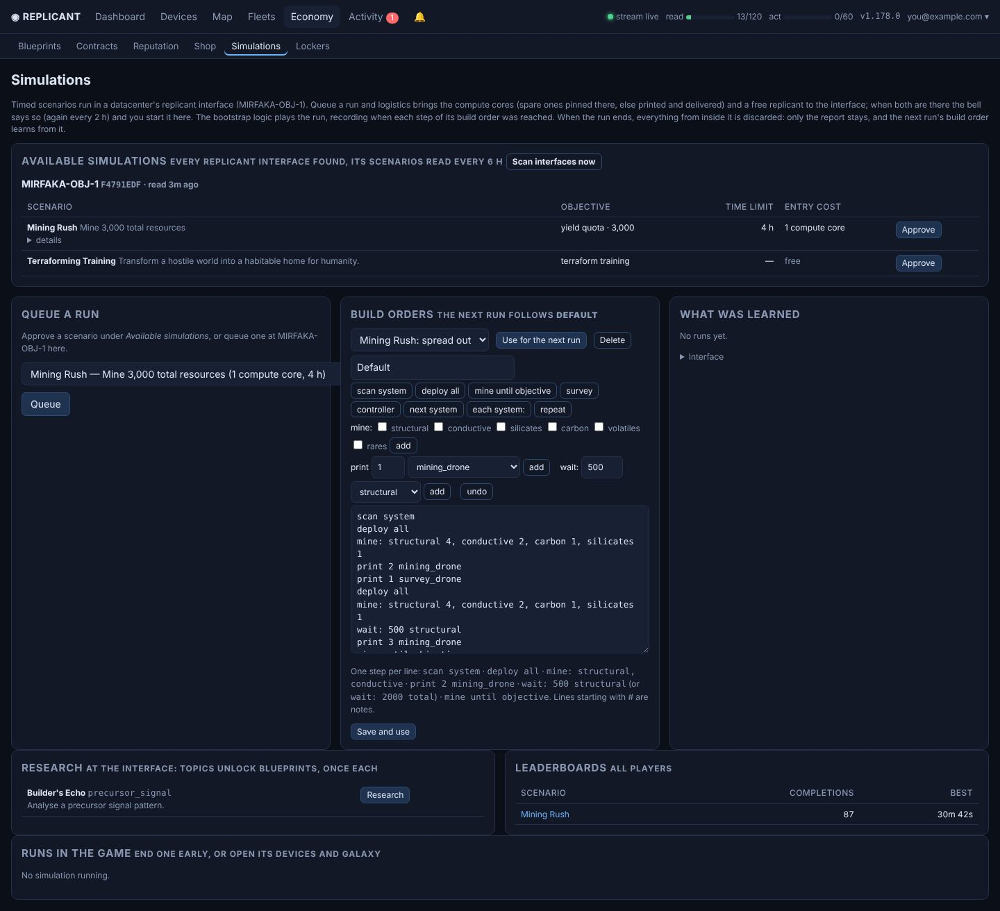

**Available simulations** lists every replicant interface known (the datacenter's, your own, and any a device scan saw)
with the scenarios each offers (GET `/devices/{code}/simulate`, read every 6 h or with *Scan interfaces now*):
objective, time limit, entry cost and details.

- **Approve** one, like a contract, and its entry cost (a free scenario has none) and a replicant go to that interface.
  Approving or queuing asks the interface at once whether it still offers the scenario and at what cost (refused
  otherwise, naming what it offers) and starts preparing right away, not on the next tick.
- **Queue a run** at the datacenter's replicant interface (MIRFAKA-OBJ-1): spare compute cores are pinned there (else
  printed at an autofactory, logistics bringing the materials, the loadout pass the cores), then a free replicant is
  sent. When cores, replicant and interface are all there, the bell nags (every 2 h) until you press *Start*.
- Also on the page: the interface's **research** topics (each unlocks blueprints, once per account; a replicant must be
  there), **data uploads** (a device with the data feature, such as a guidance chip, deployed at the interface is
  broken down for analysis; it consumes the device, so only by hand, and uploaded devices leave the list for a count by
  type), the all-player **leaderboards** (per scenario: top 10), and the game's view of a run in progress.

**Playing a run**
- The bootstrap's compounding logic plays the run on the simulation's own devices (no other automation touches them),
  recording when each build-order step was reached.
- Everything from the virtual galaxy (the VIRT… systems) is kept apart: its devices, stockpiles, stars, surveys and
  events never reach your real numbers, map or alerts; the page shows them in a Virtual galaxy card.
- A run's clock runs faster than real time, so when one of its jobs finishes the next step starts at once rather than
  on the next engine tick.
- When it ends, everything from inside it (devices, events, scans, jobs) is purged. The report stays (score, resources
  mined, devices printed, the step times).
- **Runs in the game** lists every run the game has going: *End early* on any of yours, and devices / galaxy links that
  open the normal Devices page and Galaxy map on that run's own data (`?sim=<run>`: its devices, stock and the virtual
  stars around its replicant, read live through it and cached for a minute).

**Build orders**: the next run follows the build order you choose. A Build orders card holds named orders, one step per
line; the run card crosses steps off as they're done and the timeline records when. Every system mined counts toward a
yield quota. The built-in *Mining Rush: spread out* order uses them.

| Step | Meaning |
|---|---|
| `scan system`, `deploy all` | as named |
| `mine: structural 4, conductive 2, carbon 1, silicates 1` | a number weights a resource; saving refuses an order whose print needs a resource no earlier step mines |
| `print 2 mining_drone` | print devices |
| `wait: 500 structural` | wait for a stock level |
| `mine until objective` | mine until the scenario's objective is met |
| `survey` | belt surveyors and survey drones at the belt search it |
| `controller: gather_evenly` | a mining controller at the belt adopts the drones there, takes the directive and is launched, so they keep mining after the vessel leaves |
| `next system` | the vessel flies to the nearest unvisited system with whatever it printed aboard |
| `each system:` … `repeat` | loop back to it; a system with no belt is skipped |

**Terraforming training** (a simulation played by hand; the engine plays no build order in it)
- Its run card links to *Terraforming controls*: the Terraforming page on the run's own world
  (`/terraforming?sim=<run>`, that run's reports and graphs only; cleared when it ends).
- The monitor's values against a target species' ranges (GET `/species` `environment`; Humans by default, the choice is
  remembered), ✓ / ✗, and where each is heading at its current Δ (in range in N ticks, leaves the range, moving away; a
  tick is 30 s).
- Each device's strength / direction and on/off, and *all on* / *all off* per kind of device.
- The monitor and the regulator share one *Control* card, first. The other kinds keep a fixed order by what they
  primarily do (temperature, pressure, oxygen, toxicity, hydrosphere, biosphere); those that bring an out-of-range value
  back are marked *fixes …*.
- A card is not redrawn while one of its controls is held, and a commanded switch or setting shows dashed until the game
  reports it (up to 2 min).
- Each world says whether it's *all habitable* or which values are out of range, and since when the atmospheric
  regulator has been regulating (it holds temperature, pressure and hydrosphere still and can be switched off again);
  switching it on asks first.

 

---

## Activity and tools

| Page | What it has |
|---|---|
| **Automations** | every rule, jobs step by step with Cancel, and the log; **Confirm** buttons for trips over the sector range |
| **Events** | full local history with filters |
| **Messages** | game messages (unread first and highlighted, read ones dimmed; *unread only* box) and BobNet channels (each post shows the system its poster is in; the feed searches every saved message and pages back with *Older*; *recent* history includes NPCs and pages back through the relay with *Older*) |
| **Chatter** | Write a message (pick the replicant and the channel, or type a channel). NPC chatter: your NPC replicants post canned BobNet lines about events they took part in (survey done, belt or site mined out, arrival, salvage, contract), answer each other in conversations and answer other NPCs (Bill, Riker, Dash …); placeholders {from} (the system a post names, such as the one Bill left), {star}, {region}, {poster}, {arrival} (who a post says just arrived), {pilot} (who an announcer's post is about), {score}; every message is used before any repeats. Bulk import with a tick per message, library with Post now / Remove, settings (on/off, general and bots channels, one limiter per channel, how often one of the NPCs may start a post there (24 h by default for the general and bots channels, blank = never); a refused reply is tried by another NPC; chances, daily cap), queue and posted log. Only replicants marked NPC post |
| **Notifications** | alerts and accomplishments, with toasts and a badge |
| **Leaderboards** | every board the game keeps (XP, fleet, trades, distance, reputation, colonies …), top 10 each, your replicants in bold |
| **Blog** | read and search the game's blog, write a post as one of your replicants, edit or delete your own |
| **Diagnostics** (menu) | a live snapshot (read-only GETs plus the app's state) with a mining diagnosis, downloadable as JSON; checkboxes pick its sections (request sections share the budget); Performance panel; feedback to the game's developers |
| **Console** (menu) | call any API endpoint through the server-side client |

**Sector range**: any automated trip longer than a day at the game's surge pace (or of unknown length: the game's
preview measures stars the catalog lacks) isn't sent; its job waits with a **Confirm** button on Automations (one
alert). Trips you start yourself go as they are.

**Performance** (Diagnostics): pages slowest on average, the slowest requests with their queries, game API calls,
engine lock waits and saved values decoded; engine stage timings and lock holds; table sizes and the largest saved
values (also in the snapshot). Every page answer carries a Server-Timing header, and requests over 1 s are logged.

**Console presets**: every player endpoint of the live API (including equipment-locker retrieve), grouped and each with
a one-line description, with fill-in blanks (replicant, device, location … with suggestions) that build the path and
body, which stay editable before sending.

**Repeating commands**: *Repeat* under the console form sends its POST, PATCH or PUT request now and every N minutes
until stopped (e.g. a belt scan for debris or devices). Each row counts finds in the command's system (a discovered
device or salvage, which also notify) and can stop at the first one; three failed sends in a row stop it.
The Devices page does the same for ticked devices (*Repeat on ticked*, one repeat per device), and a device page's
Command card has a *Repeat* button and lists its repeats. A repeat waits while its device doesn't offer the command.

### Desktop wallpaper (optional)
The Galaxy and System maps as a live Windows wallpaper with [Octos](https://github.com/underpig1/octos) and
[sk3ynet/replicant-space-octos](https://github.com/sk3ynet/replicant-space-octos). *Account › Desktop wallpaper* creates
a read-only link (`/wallpaper/<id>/#key=…`). Options:

| Option | Values |
|---|---|
| `view` | `galaxy`, `system` or `cycle` |
| `cover`, `fleets`, `supply`, `production` | `0` hides that layer |
| `hud` | `right`, `left` or `off` |
| `layers` | the galaxy layers that are on, by the Galaxy page's checkbox ids without `opt-` (e.g. `labels,regions,mark-hub`); every other layer is off |
| `follow` | a replicant name or code: the galaxy stays centered on it, gliding along while it travels; the system view shows the system it's in |

---

## How automation works

- **Rules** run in the app container, so they keep going with the browser closed. Each rule creates **jobs**: ordered
  game commands, some waiting for an event (e.g. `travel.arrived`) before the next.
- A failing step is logged and skipped; a failing *critical* step stops the job with an alert. Jobs are stored in
  SQLite and survive redeploys.
- All commands share the rate limiter (background budget) and appear in the Account audit log as user `automation`.
- **Dry run** makes rules log what they would do without sending anything. Watch-and-alert rules start on; every other
  rule starts off.
- **Engine watchdog**: if the engine lock is held for more than 10 minutes, the log and Diagnostics say
  **automations stalled**.
- Events that arrive more than 30 min late (a replay after downtime) go into the history only; they trigger no rules.

### Season changes
A season ends in a time skip (devices may move, events end, AMI directives pause).
- When `/overview` reports a new season number, automations pause: no engine passes, no new automated jobs, and
  running jobs wait (ones you start yourself still run). A banner says so; only **Resume automations** lifts it.
- **Pause for the season change** (Dashboard › Story) does the same by hand.
- Every 6 hours a copy of device places and states, fleets, loadouts, ward / relay / beacon orders, contract
  deliveries, replicant places and star positions is kept; it's frozen while paused.

### Long trips
E.g. ~500 ly from the home sector to the Sol zone.
- A wait for an arrival lasts until the game's own ETA (+30 min) and is extended while the device is still moving (up to
  48 h).
- A command the game refuses because something is still travelling is retried every 5 min (up to 3 h) while it's still
  heading where the job sent it.
- A canceled trip, an arrival somewhere else, or a carrier that turned back stops the job (a fleet mission stalls;
  *Retry* flies again), so nothing is deployed or unloaded anywhere but the destination.

### Via hubs
Arriving in a system with a hub is 25 % faster, whoever owns it, and the game never routes through one by itself.
- Before an automated device trip of 15 ly or more to another system, up to two hubs (yours, or any star the catalog
  flags *hub*) that could shorten it are previewed as a waypoint (`via`, dry runs).
- The fastest is taken when it saves at least 10 min and 5 %. The step then reads *(via hub X)* and the log gives both
  times; if the game refuses the waypoint the trip goes direct.
- A trip to a body in another system gets that system's star as the last waypoint (the game requires it), for a `via`
  you type yourself too.

### Surge hops
- A system has three surge spots (game docs): the Oort cloud, the Kuiper belt and the entry point (usually a planet's L5
  next to the belt). The system page lists them under Bodies.
- Inside a system, a surge-capable device standing at one of them hops first to whichever of those is nearest its destination (when that saves at least 30 AU and a quarter of
  the cruise), then cruises the rest.
- From a belt or a body it first goes to the nearest of those spots when that is much shorter than the game's own
  route (leaving a system, the game cruises to the entry point first).
- The spots go in the trip's `via`, ahead of any hub waypoints.
- **Off-ramp**: arriving in another system, the trip ends with that system's spot nearest the destination when the game
  would arrive much further off; the step reads *(surge hop via …)*. Where surges land at the entry point (a system
  we scanned, or one with a hub) the trip goes there first, hops to the spot as a trip of its own, then cruises on;
  a hand-sent trip there leaves the off-ramp out.
- If the game refuses them, the trip takes its own route. A spot refused as a loop (from the entry point to the belt)
  becomes a hop of its own first, then the trip cruises the rest; trips sent by hand from the travel forms do the same.
